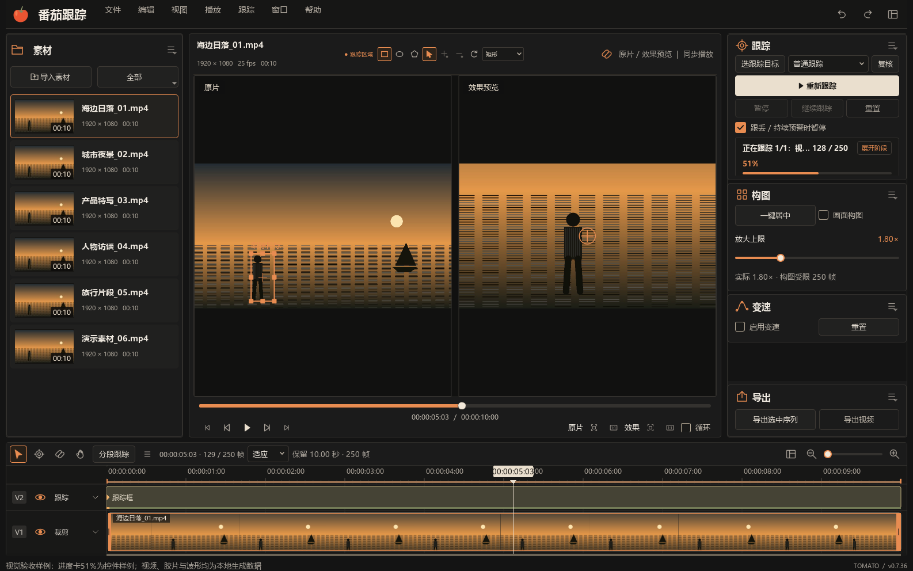

# 番茄跟踪 Tomato Tracker

一个使用 Python、Qt 和 OpenCV 编写的本地视频跟踪实验项目。它从画面中选定的区域估计运动，把主体保持在指定构图位置，并通过 FFmpeg 导出视频。项目以学习与交流为目的，由个人利用业余时间维护。

Tomato Tracker is an experimental, locally operated video tracking and subject-locking tool for Windows. It supports manual correction, synchronized previews, batch processing and optional time remapping.

当前版本是 **v0.7.36**，主要在 Windows 上开发和测试。复杂遮挡、反光、快速运动和长镜头仍需要人工检查和修正。



截图中的视频与进度为合成的界面演示数据。

## 功能

- 单个或批量导入视频，为每条素材设置范围和跟踪区域。
- 普通与精准跟踪，多关键帧、独立分段、暂停修正与检查点续跑。
- 原片与效果双预览，查看跟踪状态，调整目标位置与放大上限。
- 使用曲线编辑速度，支持倒放、定格以及可选的本地 DIS 光流插帧。
- 单条和批量导出，支持原速保留原音，变速时根据设置处理音频。
- 本地自动保存、工作区恢复及诊断包导出。

跟踪、预览和导出在本机完成。部分效果使用视频代理，最终导出仍从原视频读取。GPU 编码取决于设备和 FFmpeg 支持，光流插帧使用 CPU 的 OpenCV DIS。

## Windows 快速开始

准备 64 位 Windows、Python 3.12，以及可以从命令行调用的 FFmpeg 和 FFprobe。FFmpeg 需要包含 H.264 编码器（例如 libx264）；GPU 编码功能还需要对应的编码器和驱动。

```powershell
git clone https://github.com/2312559117/LANG.git
cd LANG
py -3.12 -m venv .venv
.\.venv\Scripts\python.exe -m pip install -r requirements.txt
.\.venv\Scripts\python.exe main.py
```

如果 FFmpeg 不在 PATH 中，可以在启动前设置 `$env:LOCKFRAME_FFMPEG_DIR = '包含ffmpeg.exe和ffprobe.exe的目录'`。当前源码包不包含 FFmpeg 二进制文件，下载和使用时请留意所选构建的许可证。

在左侧导入素材，在原片预览中框选目标并开始跟踪。检查时间轴上的跟踪状态，必要时暂停并在问题帧重新选区，再继续跟踪。完成后调整构图并导出。

## 开发和测试

```powershell
.\.venv\Scripts\python.exe -m pip install -r requirements-dev.txt
$env:QT_QPA_PLATFORM = 'offscreen'
.\.venv\Scripts\python.exe -m pytest -q
```

需要 FFmpeg 和 FFprobe。可使用 `build_windows.ps1` 打包 Windows 便携目录，依赖 PyInstaller。运行前通过 `-FfmpegDirectory` 指定包含两款工具的目录；如果发行包的许可文件不在该目录的上一级，请使用 `-FfmpegLicenseFile` 和 `-FfmpegReadmeFile` 指定同一 FFmpeg 构建的许可证和说明文件。公开分发前仍须核实所用 FFmpeg 构建及其他依赖的完整许可证义务。项目保留现有的应用内离线自检入口与第三方许可证。

## 已知限制

- 分析使用固定帧率时间基，尚未重建变帧率视频的原始 PTS。
- 当前实验结果不代表任何特定商业软件的实现或精度。跟踪置信度不是目标识别成功的概率。
- 连续播放使用代理预览，暂停后可使用原片高清检查；最终效果请以导出文件为准。
- 长镜头、遮挡和低纹理场景需要更多真实素材与人工验收。
- 个人维护，功能和接口可能调整，欢迎提出可复现的问题。

## 参与贡献

欢迎通过 Issue 分享复现步骤、功能想法或使用体验，也欢迎提交 Pull Request。提交诊断信息前请检查日志中是否包含不想公开的文件名或其他信息。详见 [贡献指南](CONTRIBUTING.md) 和 [安全问题说明](SECURITY.md)。

## 许可和致谢

项目现有许可文件为 GPL-3.0-only，第三方材料及来源见 [THIRD_PARTY_NOTICES.md](THIRD_PARTY_NOTICES.md)。**公开发布前仍需核实部分参考其他软件研究实现的再分发权限**。

感谢 [lockOn](https://github.com/mo3rfan/lockOn) 和 [StableFlowPro](https://github.com/liangtovi-debug/StableFlowPro) 的开源工作，以及 Python、Qt、OpenCV、NumPy 与 FFmpeg 社区。
